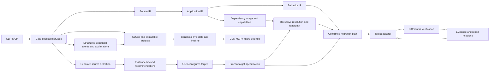

# Architecture overview

Rewrotron separates the syntax of an application, its structural relationships, and its observed behavior. Source adapters produce source facts and framework interpretations; the deterministic services assemble evidence and contracts; target adapters consume the same behavior records regardless of source language.

This is an execution diagram. Go imports follow the [component map](COMPONENTS.md): framework-neutral services use injected ports; `internal/runtime` wires concrete adapters and storage. All entrypoints share the same gate checks. A caller cannot bypass them by invoking a worker directly.

Target generation is bounded by adapter capabilities and evidenced business rules. The IR does not make undocumented business logic executable by itself. An unsupported rule or incomplete observation yields a blocker, and optional agent proposals remain proposals until accepted and verified.

[System design](SYSTEM-DESIGN.md) defines the ports, [IR contracts](../02-domain/IR-CONTRACTS.md) define their records, [recovery](../08-storage/RECOVERY.md) defines durable publication, and [security](../09-security/SECURITY.md) defines execution trust boundaries. The first extension model is build-time adapter registration. A dynamically loaded third-party plugin ABI is outside the first release.
