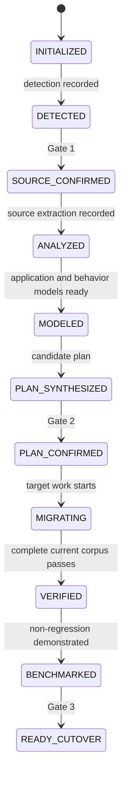

# Project lifecycle and engine gates

**Status:** Canonical state machine. State names are case-sensitive and used unchanged in SQLite, CLI, MCP, and project snapshots.

## Workspace versus analysis

`init` creates only the minimal workspace, configuration, SQLite store, and source detection proposal. `detect` may initialize that same minimal workspace. Creating the store is necessary to persist explicit approval; neither command parses the application deeply, runs source code, selects a target, or confirms a gate. Target configuration may be absent until planning. Root `rewrotron.yaml` owns intent; detection and approval YAML files are generated views. Freeze the validated target revision before feasibility/planning; Gate 2 confirms it with the plan, without a separate target approval state.

## Transitions and prerequisites

| Operation | Starting states | Result | Guard |
| --- | --- | --- | --- |
| `init`, first `detect` | No workspace | `INITIALIZED`, then `DETECTED` | Source readable; workspace and target do not overlap |
| `confirm source` | `DETECTED` | `SOURCE_CONFIRMED` | Explicit human action for current merged baseline |
| `analyze` | `SOURCE_CONFIRMED`, `ANALYZED` | `ANALYZED` | Valid Gate 1; artifacts complete or scoped blockers recorded |
| `observe` | `ANALYZED` or later | Same state; observation appended | Valid Gate 1; isolated environment and fixture ready |
| `discover` | `ANALYZED`, `MODELED` | `MODELED` | Application IR and evidenced contracts materialized; unsupported areas disclosed |
| `plan` | `MODELED` or later | `PLAN_SYNTHESIZED` | Valid Gate 1; frozen user target, recursive dependency feasibility/decisions, capabilities, omissions and blockers recorded |
| `confirm plan` | `PLAN_SYNTHESIZED` | `PLAN_CONFIRMED` | Valid Gate 1; no generation-blocking unresolved items in approved scope |
| `migrate`, target repair | `PLAN_CONFIRMED`, `MIGRATING` | `MIGRATING` | Valid Gates 1/2; unit ready; patch fencing succeeds |
| `verify` | `MIGRATING`, `VERIFIED` or later | `VERIFIED` only when aggregate passes | Current source/plan/target/corpus hashes; all required dimensions observed |
| `benchmark` | `VERIFIED`, `BENCHMARKED` | `BENCHMARKED` only on evidence-backed acceptance | Current verification; pinned workload and environment |
| `confirm cutover` | `BENCHMARKED` | `READY_CUTOVER` | Gate 3 on current release, no required unknowns, rollback and session evidence |
| `cutover prepare` | `READY_CUTOVER` | Same state | Package only the approved subject; no production changes |

Observation is an operation, not a competing project state. `BLOCKED`, `FAILED`, and `NEEDS_HUMAN_REVIEW` are mission/operation statuses; the project retains its last durable state plus blocker records. `resume` reconciles unfinished work and returns a snapshot; it never advances a gate.

## Repetition and invalidation

Read-only status and report operations never change lifecycle state. Repeated analysis/discovery with identical inputs can reuse immutable results; changed contracts invalidate plans. Replanning always creates a new candidate and invalidates old Gate 2/3 validity. For projects already at `MODELED` or later, a target-intent change returns the project to `MODELED` while replanning, then `PLAN_SYNTHESIZED`; earlier projects retain their last source lifecycle state; it preserves valid Gate 1, source/behavior analysis and unaffected unit artifacts. Pending changed intent prevents new target execution and stale worker publication. A project state rollback does not erase completed unit history. Dependency impact determines which target/build/verification results need revalidation; unchanged inputs may be reused after freshness checks under a newly approved plan. See [target specification](../04-migration/TARGET-SPECIFICATION.md). Source drift returns to `DETECTED`. A target repair or failed regression returns verified/benchmarked projects to `MIGRATING`; a changed benchmark report returns a ready project to `VERIFIED` until it is benchmarked and approved again.

Transitions, guard checks, state changes, and events commit in one transaction. Long work happens outside the transaction and is published only if its captured hashes and fencing token remain current. Compare the prior state/revision on update; competing workers cannot advance an outdated revision.

Unit states are `DISCOVERED`, `PLANNED`, `GENERATING`, `GENERATED`, `VERIFYING`, `VERIFIED`, `COMPLETED`, `BLOCKED`. `COMPLETED` means current evidence satisfies the unit definition of done. Project verification still reruns the frozen aggregate corpus. Unknown behavior prevents equivalence for the affected scope; it can be excluded only through a visible, newly confirmed plan, with no claim of full application parity.

Hash definitions and human approval requirements are specified in [CONFIRMATION-PROTOCOL](CONFIRMATION-PROTOCOL.md).

## Execution display and human control

The visible stages DETECT/CONFIRM/ANALYZE/OBSERVE/MODEL/PLAN/MIGRATE/VERIFY/REPAIR/OPTIMIZE/FINALIZE label repeatable concurrent work, not durable project states. Live WAITING_USER/BLOCKED/PAUSED/STALE presentation derives from current runs/findings/control and captured subjects. Stage completion does not advance a gate or certify parity.

A human pause stops new claims and acknowledges only after safe checkpoints/publication reconciliation. It preserves the lifecycle, approvals and history. Explicit `continue` rechecks prerequisites; `resume` and restart reconcile while retaining pause. Missing/stale gates remain blockers after continue. [EXECUTION-OBSERVABILITY](../06-agent/EXECUTION-OBSERVABILITY.md) owns control/status semantics.
